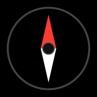
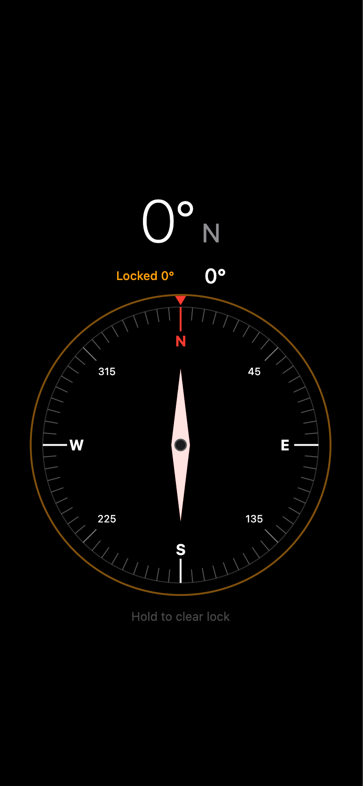

<div align="center">
  
  <h1>Compass Enhanced</h1>
  <p>Compass Enhanced is a precise digital compass as a Progressive Web App – available offline, installable on your home screen, no app store required. Long-press the compass to lock a heading and track your deviation in real time. Feels native, runs entirely in the browser.</p>
</div>

---

<div align="center">
  
</div>

---

## Features

- Live heading via device orientation sensors
- Lock a heading with a long-press — see deviation in real time
- Offline-capable PWA, installable on iOS and Android home screens
- No app store, no install, no tracking

## Tech Stack

- [SolidJS](https://www.solidjs.com/) + TypeScript
- [Vite](https://vitejs.dev/) + [vite-plugin-pwa](https://vite-pwa-org.netlify.app/)
- nginx (production container)

## Development

```bash
npm install
npm run dev        # http://localhost:5173
npm run build      # production build → dist/
npm run preview    # serve production build locally
```

## Deployment

Copy `compose.default.yml` to `compose.yml`, fill in your domain and Traefik settings, then:

```bash
docker compose up -d --build
```
